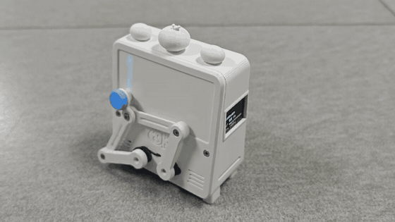
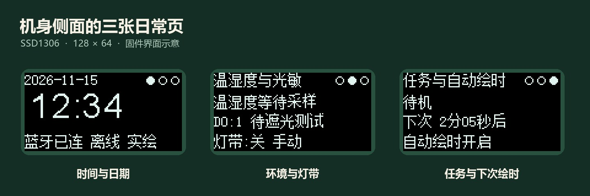

# 噜噜绘时钟 · LuluClock V2

**让时间，留下痕迹。**

两只舵机控制一个紫外灯头，把时间、文字和手绘轨迹画在蓄光板上。
从 R16 A1 整机打印到第一次光绘，模型、接线和源码都在这里。

**5.2.2 · ESP32-S3 N16R8 · Android 8+ · R16 装配修订 A1**

[开始复刻](#从零复刻) · [网页版教程](https://yuhuang007.github.io/LuluClock_V2/) · [一键下载十件 STL](https://github.com/yuhuang007/LuluClock_V2/releases/download/v5.2.2/LuluClock-5.2.2-STL.zip) · [源码导航](#源码导航)

## 从零复刻

**整机需要打印 10 件：六件外壳零件、四件机械臂。** 外壳采用项目的 R16 装配修订 A1，提供可编辑 Blender 文件；直接用 STL 切片即可。没有打印机也可以用 [1:1 模板](hardware/bench-jig.svg) 先搭开放台架。

| 步骤 | 做什么 | 到这一步能确认什么 |
| --- | --- | --- |
| 01 备料 | [物料清单 CSV](hardware/bom.csv)；准备 ESP32-S3 N16R8、双 SG90、底板、三键和限流电源 | 核对板型、供电、舵机和紧固件 |
| 02 打印与试装 | [打印清单](hardware/enclosure/README.md) · [外壳 Blender](hardware/enclosure/LuluClock-R16-A1.blend) | 按毫米、100% 切片，核对舵机轴心距 **25.00 mm**，先试装别急着合壳 |
| 03 接线 | [5.2.2 接线与上电](hardware/wiring.md) | 正面看左舵机 GPIO5、右舵机 GPIO4；GPIO6/11 只驱动外部电路 |
| 04 烧录 | [Arduino IDE / CLI](firmware/README.md) | 空板用完整串口烧录；主控能启动、App 能找到设备 |
| 05 连接与校准 | [安装 APK](https://github.com/yuhuang007/LuluClock_V2/releases/download/v5.2.2/LuluClock-5.2.2.apk) · [装臂与空走](hardware/README.md#3-装臂和校准) | 先断开灯头，检查 A/B 姿态、归位和碰撞 |
| 06 实绘 | 创作 → 测试图形 → **10 × 10 mm 校验方框** → 发送 | 用尺测横纵尺寸，然后试文字与时间 |

网页版有逐项勾选进度和常见问题：[在线打开](https://yuhuang007.github.io/LuluClock_V2/)；离线可在下载后的目录中打开 [`docs/index.html`](docs/index.html)。

> 实拍为项目原型。六件外壳使用 R16 A1 交付网格；四件连杆为按同一运动几何重做的打印件，已校核数字尺寸与网格，和外壳的完整实体配合仍需试装。

公开版 APK 使用独立签名。如果设备上已有不同签名的安装包，先按 [Android 说明](android-app/README.md) 处理，避免丢失本地收藏。

## 实机效果

  

**[原型演示视频（约 3 分 46 秒）](https://github.com/yuhuang007/LuluClock_V2/releases/download/v5.2.2/LuluClock-V2-Prototype-720p.mp4)** 展示真实绘时、平板发送「你好世界」和实体按键。手机与横屏平板共用一个 APK；应用还有手绘、收藏、倒计时与番茄钟。

查看 App 与 OLED 界面

OLED 为 0.96 英寸 SSD1306（128 × 64）。设备空闲时长按中键 5 秒进入设置，松开后左键选项、右键改值、中键短按保存；松开后再长按中键 5 秒退出。

## 一笔是怎么画出来的

App 将手绘或汉字笔顺转换为毫米坐标。ESP32-S3 对轨迹做可达性检查和运动规划，输出两路舵机目标；落笔亮灯，换笔灭灯移动。蓄光板会短暂保留线条。装配精度、光斑和板面间隙决定实物结果，软件中的目标位置不是传感器实测值。

## 源码导航

| 目录 | 从这里开始 |
| --- | --- |
| [`hardware/`](hardware/) | 物料、十件 STL、R16 A1 可编辑 Blender、接线与校准 |
| [`firmware/`](firmware/) | `JianClock.ino`、几何、运动规划、BLE、OLED、Arduino 配置 |
| [`android-app/`](android-app/) | Java + WebView 应用、手动 OTA、可自签的构建脚本和 Node 回归 |
| [`docs/`](docs/) | 无需联网依赖的网页教程、原型配图与界面示意 |

- **改硬件或轨迹**：[固定引脚与设置](firmware/JianClock/Config.h) · [几何求解](firmware/JianClock/Geometry.h) · [亮灯与暗移时序](firmware/JianClock/MotionExecutor.h)。
- **改 App**：[Android 环境与构建](android-app/README.md) · [WebView 入口](android-app/assets/index.html)。自己编译默认输出未签名 APK，可用自己的本地开发密钥签名。
- **验证与升级**：固件用 Arduino ESP32 **3.3.12**、U8g2 **2.36.19**；应用用 JDK 17、Android SDK 35。空板首次烧录走串口。公开版 APK 不内置固件，兼容设备可在 App 里手动选择本地编译的应用镜像做 OTA。

## 来源与许可

见 [来源与许可说明](THIRD_PARTY.md)。第三方汉字数据保留原许可与来源记录；原创代码和文档尚未指定统一许可证，公开可见不等于所有内容均按同一许可授权。
