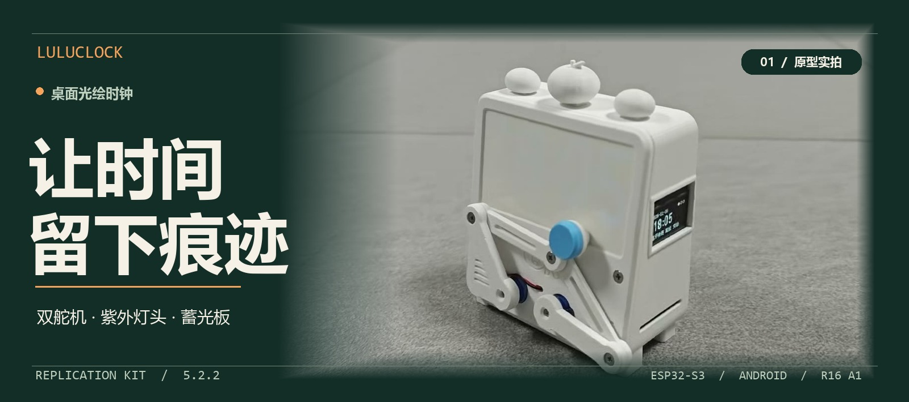
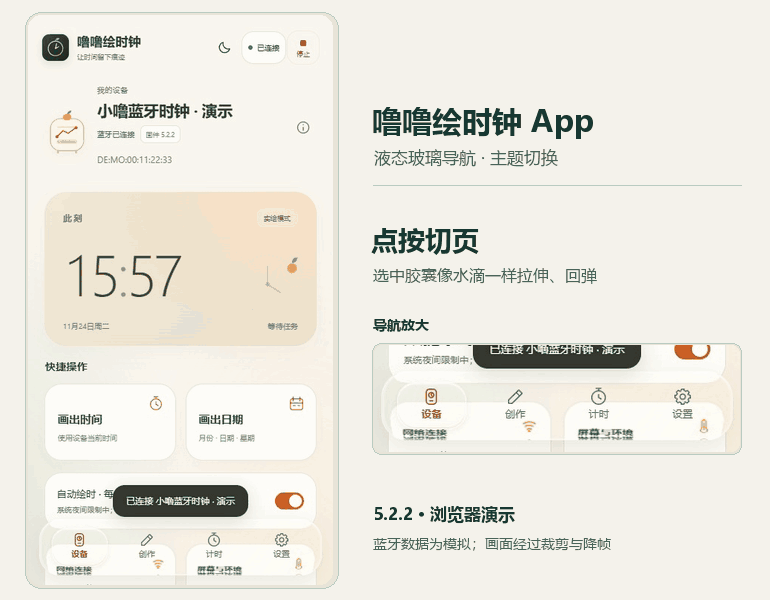
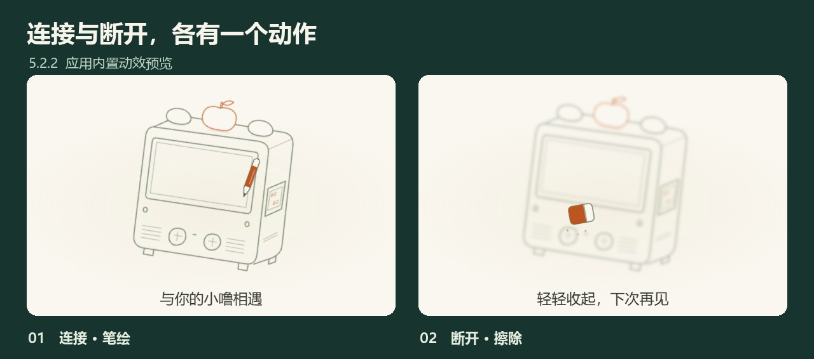
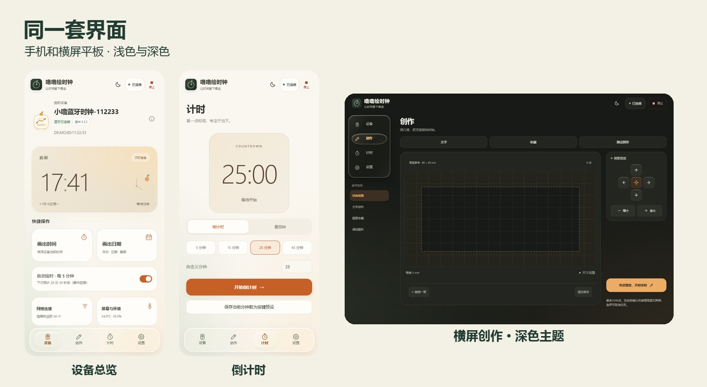
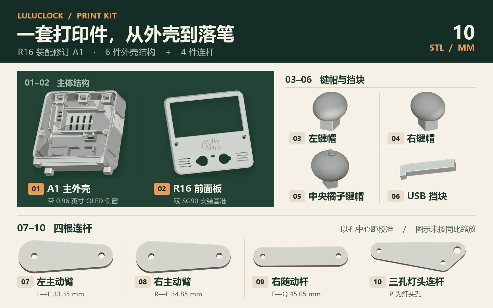
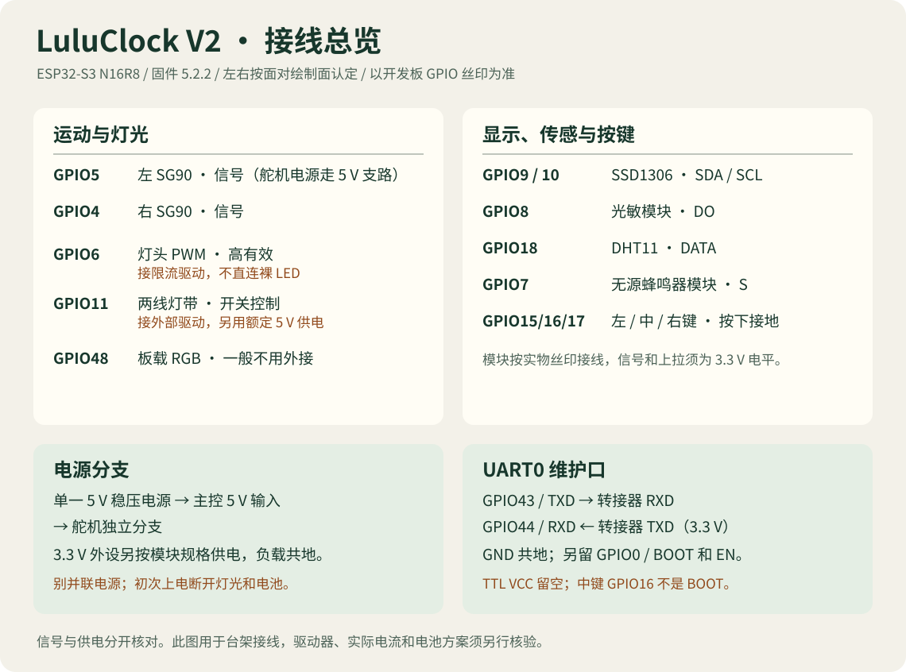
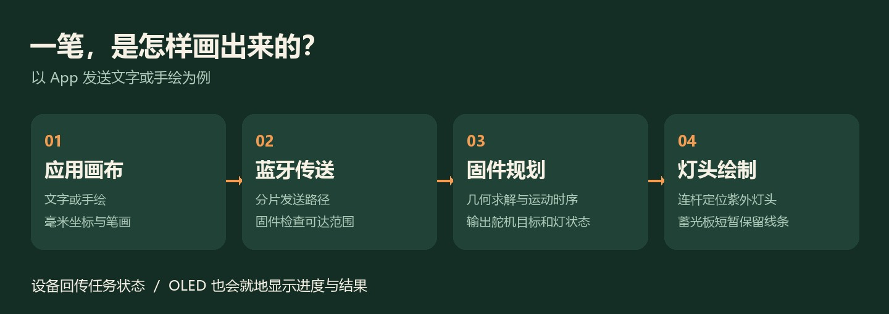

# 噜噜绘时钟 · LuluClock V5.2.2

**一台会用光画画的桌面时钟。**

两只舵机带动灯头，在蓄光板上写下时间、汉字和手绘图案。 
这里有 R16 A1 外壳、整套打印件、固件和 Android App，可以跟着教程从零复刻。

  

[开始复刻](https://yuhuang007.github.io/LuluClock_V5.2.2/) · [下载 STL](https://github.com/yuhuang007/LuluClock_V5.2.2/releases/download/v5.2.2/LuluClock-5.2.2-STL.zip) · [下载 APK](https://github.com/yuhuang007/LuluClock_V5.2.2/releases/download/v5.2.2/LuluClock-5.2.2.apk) · [作品视频](https://github.com/yuhuang007/LuluClock_V5.2.2/releases/download/v5.2.2/LuluClock-Prototype-720p.mp4)

**ESP32-S3 N16R8 · 双 SG90 · 可选 SSD1306 · Android 8+**

[实拍](#01--实际画出来是什么样) · [App 动效](#02--app-的液态玻璃与动效) · [打印](#03--外壳和机械臂一次下齐) · [复刻](#04--从备料到第一笔) · [原理](#05--一笔怎么到达板面) · [源码](#06--工程地图)

## 01 · 实际画出来是什么样

  

画线时灯头亮起，换笔时灭灯移动。完成后，线条会在板面短暂停留。它能按计划绘时，也能从 App 接收「你好世界」或随手画的图案。

**[下载 3 分 46 秒作品视频](https://github.com/yuhuang007/LuluClock_V5.2.2/releases/download/v5.2.2/LuluClock-Prototype-720p.mp4)**，内含整机实拍、App 与实机联动、OLED 操作及带标注的原理演示。

| 创作 | 时间与交互 | 自定义 |
| --- | --- | --- |
| 汉字按笔顺生成、自由手绘、尺寸预览、图案收藏 | 自动绘时、倒计时、番茄钟；机身侧屏显示时间、环境与任务 | 手机和平板布局、深浅主题、界面动画开关；OLED 亮度与休眠 |

## 02 · App 的液态玻璃与动效

手机底栏和平板侧栏以透明材质、边缘折射和滑动胶囊显示当前位置：手指移动时，胶囊跟随；松手切页时，拉伸并回弹。深浅主题则从点击点以圆形展开。

  

**连上的时候，用笔画出一台小钟；主动断开时，用橡皮擦把它收起来。** 应用内「设置 → 外观与主题 → 完整动效」可预览连接与断开，无需连接设备。动效也可以跟随系统或关闭。

<strong>展开：笔绘与擦除、手机与平板、侧面 OLED</strong>

OLED 是 0.96 英寸 SSD1306，128 × 64。设备空闲时长按中键 5 秒进入设置，松开后左选、右改、中键短按保存；再次松开并长按中键 5 秒退出。

本节 App 动图与截图由当前应用在浏览器中渲染，样例设备状态为模拟；折射及主题效果取决于 Android WebView 的支持情况。

## 03 · 外壳和机械臂一次下齐

| 下载 | 里面有什么 |
| --- | --- |
| **[整机 STL 压缩包](https://github.com/yuhuang007/LuluClock_V5.2.2/releases/download/v5.2.2/LuluClock-5.2.2-STL.zip)** | **10 件**：主壳、前面板、三颗键帽、USB 挡块、四根连杆；附部件清单及 SHA-256 |
| **[R16 A1 外壳 Blender 文件](hardware/enclosure/LuluClock-R16-A1.blend)** | 六个外壳零件的可编辑网格；机械臂使用随包 STL |
| **[逐件 STL 与装配说明](hardware/enclosure/README.md)** | 打印方向、关键中心距、试装顺序和合壳前检查 |
| **[A4 台架图](hardware/bench-jig.svg)** | 1:1 校核轴心距和孔位；没有打印机也可先用平板搭台架 |

外壳是 R16 装配修订 A1。四件臂按原运动中心距另行绘制，已核对尺寸及闭合网格；与外壳的实物配合仍需试装。打印用 **毫米、100%**；舵盘、螺丝、灯珠和蓄光板另备。

## 04 · 从备料到第一笔

**完整步骤见 [网页版教程](https://yuhuang007.github.io/LuluClock_V5.2.2/)**，可以边做边勾选。离线解压后双击 [`docs/index.html`](docs/index.html)。

| 步骤 | 看哪份资料 | 完成标志 |
| --- | --- | --- |
| **01 备料** | [物料表](hardware/bom.csv) | ESP32-S3 N16R8、两只 SG90、5 V 限流供电和紧固件齐全 |
| **02 打印与试装** | [R16 A1 外壳和 STL](hardware/enclosure/README.md) | 轴距 **25.00 mm**，舵盘防转固定，手动行程无卡滞 |
| **03 分步接线** | [接线图、供电与上电顺序](hardware/wiring.md) | 正视左舵机 **GPIO5**、右舵机 **GPIO4**；灯头驱动暂不接入 |
| **04 首次烧录** | [Arduino IDE / CLI](firmware/README.md) | 空板经串口刷入，App 找得到设备 |
| **05 装臂与空走** | [校准步骤](hardware/README.md#3-装臂和校准) | A/B 姿态、归位、运转间隙和线束通过检查 |
| **06 第一次实绘** | 创作 → 测试图形 → **10 × 10 mm 校验方框** | 用尺测横纵尺寸，再试时间和汉字 |

<strong>展开 5.2.2 接线总览</strong>

GPIO6、GPIO11 是控制信号，分别接灯头限流驱动和灯带驱动。双 SG90 用合适的 5 V 负载支路，与主控共地。详情和分步检查见 [接线说明](hardware/wiring.md)。

## 05 · 一笔怎么到达板面

1. **迹线生成**：App 把手绘或汉字笔顺换算成毫米坐标，经 BLE 分段发送。
2. **运动求解**：ESP32-S3 检查可达范围，分别计算两个舵机的目标和运动时序。
3. **实机成像**：连杆定位灯头，按笔画亮灭。固件控制的是开环目标，实际尺寸和亮度仍由机械校准与光学间隙决定。

## 06 · 工程地图

| 目录 | 主要内容 |
| --- | --- |
| [`hardware/`](hardware/) | R16 A1 外壳、十件 STL、17 项物料表、接线和校准 |
| [`firmware/`](firmware/) | `JianClock.ino`、ESP32-S3 / BLE / OLED、运动规划 |
| [`android-app/`](android-app/) | Java + WebView，手绘与汉字、液态玻璃、手动 OTA 和回归 |
| [`docs/`](docs/) | 自包含网页版教程、实拍、动图和复刻图解 |

**构建入口**：[ESP32-S3 固件](firmware/README.md)使用 Arduino ESP32 **3.3.12** 与 U8g2 **2.36.19**；[Android 源码](android-app/README.md)使用 JDK 17 与 Android SDK 35，默认编译未签名包。Release APK 用独立签名，不能覆盖同包名的不同签名版本。公开 APK 不内置固件，兼容设备可手动选取本地编译的应用镜像进行 OTA。

**源码坐标**：[引脚配置](firmware/JianClock/Config.h) · [几何求解](firmware/JianClock/Geometry.h) · [运动规划](firmware/JianClock/MotionExecutor.h) · [App 界面](android-app/assets/index.html) · [玻璃和主题](android-app/assets/app418.js) · [连接动效](android-app/assets/connection-motion.js)

**来源与许可**：见 [THIRD_PARTY.md](THIRD_PARTY.md)。汉字笔顺等第三方素材保留原许可；原创代码、设计和文档尚未指定统一授权。
