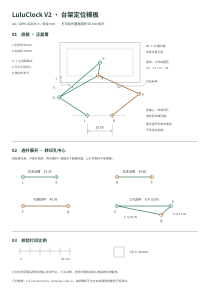

# 硬件复刻 · R16 A1

完整外壳使用 **R16 装配修订 A1**，搭配 ESP32-S3 N16R8、双 SG90 和 0.96 英寸 OLED。可以直接打印外壳和连杆；手边没有打印机时，可按 A4 模板用平板搭台架，两条路线共用接线、校准和首次绘制步骤。

[R16 A1 打印与模型](enclosure/README.md) · [全套 12 件 STL](enclosure/stl/) · [物料清单 CSV](bom.csv) · [接线](wiring.md) · [从首次上电到第一笔](commissioning.md) · [实机验证记录](validation-record.md)

## 1. 备料

首轮需要 ESP32-S3 N16R8、两只 SG90、三只瞬时按键、四根连杆、5 V 稳压电源和固定机构。实绘另需名义 80 × 40 mm 的蓄光板与有限流的灯头驱动。准备钢尺或游标卡尺、万用表、紧固件和垫片。DHT11、光敏、蜂鸣器和灯带按需添加。第一次通电先用电流能力充足且可限流的稳压电源，灯头、灯带和电池先断开。

**N16R8 标识 16 MB Flash、8 MB OPI PSRAM。** 不同底板的外形、下载口、5 V 输入和板载 RGB 接法可能不同；按手上板卡的丝印和资料核对。

印外壳前量手上的模块。R16 A1 侧窗按 **0.96 英寸 SSD1306** 布置，原模块 PCB 为 **27 × 28 mm**，27 × 19 mm 是观察区域的参考。不同批次的玻璃位置、排针顺序与伸出长度可能不同。轻触开关原型为 6 × 6 mm、H7 柱头；键帽孔按约直径 3.8 mm、深 2 mm 设计。SG90 安装耳位、输出轴偏置和舵盘孔位置也要按实物试装。

## 2. 打印外壳或搭开放台架

### R16 A1 外壳路线

1. 从 [R16 A1 打印与模型](enclosure/README.md) 下载。`01–06` 是 **主壳、前盖、三枚键帽、USB 挡块**，`07–10` 是 **低座和高座主动臂、两孔直槽随动杆、三孔灯头连杆**，`11–12` 是 **正面绘制屏背板、灯光盖**，每件各打印一个。[外壳 Blender 模型](enclosure/LuluClock-R16-A1.blend) 保留 01–06 六件；其他件从对应 STL 打印。
2. 在切片器中按毫米、100% 比例导入。主壳以后背贴打印平台、前开口朝上；0.4 mm 喷嘴和 0.16–0.20 mm 层高可作为外壳起点。先看凹刻、OLED 窗、USB 滑槽和前盖舵机座的桥接/支撑；键帽按侧躺姿态检查导杆支撑。先试打印或测量小件，不用整体缩放去迁就个别孔位。
3. **先试装再焊接/固定。** 顶部先放三只按钮，再试键帽回弹；蜂鸣器、温湿度、光敏、OLED 依次从前开口试入，OLED 针排向下再移向侧窗。需要内置 Type-C 模块时，先对准背孔入座，再从前方放下 USB 挡块、向右滑入。把主板遮住的模块和线束放好后再装 S3；留出固件下载、散热和拆卸空间。可选底部灯带的槽参考 75 × 8 × 3 mm，只在实物允许的弯曲范围安装。
4. 在壳外把双 SG90 试装到前盖，按实物试穿螺钉、舵盘和垫片。07 和 08 的 STL 总高分别为 6.25、7.62 mm，左右以试配后形成的错层、紧固和全行程间隙为准。面对绘制面左舵机接 GPIO5、右舵机接 GPIO4。检查连杆之间、螺钉头到前盖的净空，把活动线束引到机构外侧。
5. 将 11 号背板试放到**正面绘制窗**，核对框位、蓄光材料厚度及插入后合壳间隙。试合 12 号灯盖，核对盖体固定、出光、灯头到板面的净空和活动引线。在前盖可拆且灯头断电时，按[接线](wiring.md)和[校准](#3-装臂和校准)检查，再试将前盖微倾让过下沿后合拢。确认线束未被夹后再固定。此组合已做数字检查，还需实体试装。

### 1:1 模板路线

1. 下载 [bench-jig.svg](bench-jig.svg) 并在浏览器打开，按 **A4、实际大小（100%）** 打印，关闭页眉页脚。用实尺核对纸上的 **50 mm** 标尺和 **10 × 10 mm** 方形；尺寸偏了就关掉适合页面/缩小选项重新打印。
2. 面对绘制面看，图纸向右为 X 正、向上为 Y 正，两舵机轴心在同一水平线上，轴到轴 **25.00 mm**。按两个轴心固定舵机；支架开孔按手上 SG90 的实际轴偏置、耳孔和线缆尺寸另量。注意 25 mm 是两输出轴间距，不是两壳体中心距。两台舵机的输出轴方向须与绘制面垂直，舵机壳体、法兰与走线留足空间。
3. 可用 [STL 连杆](bench/README.md)，也可按模板手工制作平板连杆，用于检查固件名义几何。量**孔中心距**而非杆的总长。舵盘、螺钉、灯头和错层按实际零件试配；关节应能顺滑转动且无明显晃动。
4. 左右连杆在图示动作中可能交叠，装配时用垫片做错层，逐段检查整个行程的夹点，并让灯线有余量。打印件使用刚性材料（如 PLA 或 PETG），先试一件验证孔径、壁厚和抗弯；夹紧连接件不等于夹死转轴。
5. 蓄光板放在灯头的发光一侧，保证运动面平行、灯头不刮板且间隙尽量一致。图中纸面 80 × 40 mm 轮廓以 App 画布参考中心绘出，仅供**可调定位**；实际贴板位置以空走和实绘校验为准。

### 固件名义几何（mm）

字母和孔位与模板一致。面对正面，左轴 `L=(26.1, -30.5)`、右轴 `R=(51.1, -30.5)`；`E` 和 `F` 是左右主动臂的末端关节。灯珠光斑中心 `P` 与右随动杆的接点 `Q` 都在同一块三孔连杆上。

| 零件 | 求解使用的名义中心距 |
| --- | --- |
| 左主动臂 L–E | 33.35 |
| 右主动臂 R–F | 34.85 |
| 右随动杆 F–Q | 45.05 |
| 三孔连杆 E–P–Q | E–P 53.85；E–Q 45.05；P–Q 13.00 |

三孔连杆在 `E=(0,0)`、`P=(53.85,0)`、Y 向上时，`Q≈(44.200,-8.711)`，即从 E 指向 P 看，Q 在右侧。**不要镜像**。模板标出了参考解：灯头在 `(39,22.5)` 时，`E≈(-1.954,-12.466)`、`F≈(78.411,-8.852)`、`Q≈(37.317,9.609)`；如手动摆出的机构分支与图不符，先纠正装配。

长度与坐标基准来自 [`Geometry.h`](../firmware/JianClock/Geometry.h)；App 可上传 X 6–72 / Y 9–36 mm，参考板面中心 `(39,22.5)`。07、08 的 STL 孔中心距均约 **35 mm**；灯头实际光斑还受安装位置影响。舵机校准只调零点和角度到脉宽的比例，不能把实际孔距变成固件名义值。以空走安全、实绘尺寸和边缘行程作为验收依据。

## 3. 装臂和校准

按[首次上电到第一笔](commissioning.md)的顺序配对、试舵机、装臂、空走和实绘。**首次配对断开双舵机和绘制灯；A/B 和机械校准期间，绘制灯驱动保持物理断电。**

- 正面观察 **A：左臂水平向左，右臂竖直向上；B：左臂竖直向上，右臂水平向右**。A 位标记齿位后断电装舵盘；装臂模式中也可短按中键切换 A/B。
- App 校准页每次少量调整零点与比例，确认后保存。观察左比例用 B，右比例用 A；退出装臂会向 `(58,-1)` 附近归位，提前清出行程。
- 先空走方框、十字和近边缘轨迹，确认不碰壳、不夹线；灯头限流与控制测试通过后，再实绘 **校验方框 10 × 10 mm**，把宽、高和试装数据填入[实机验证记录](validation-record.md)。

## 4. 试装外壳前

先让舵机与联网一起跑几轮，验证供电无复位、结构无擦碰、OLED 及按键可用。保留 UART 下载入口、散热和线缆余量，避免把裸露引线放进机构行程。小批打印或开孔先做样件。台架模板是可复刻的几何起点，电器额定值、强度和整机装配仍由实际用料验证。
