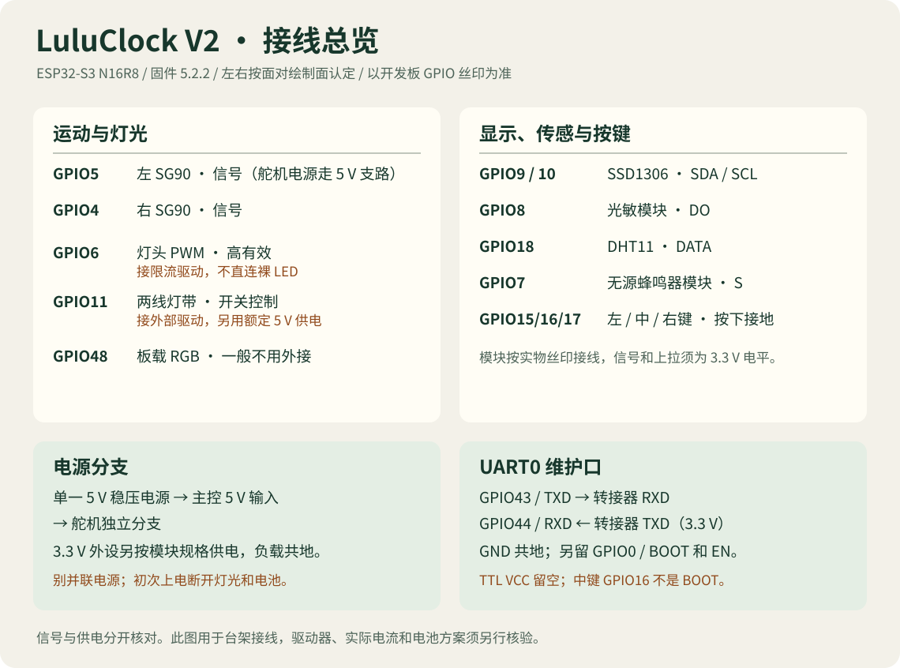

# 接线与首次上电

接线表对应 **5.2.2 / ESP32-S3 N16R8** 的 [`Config.h`](../firmware/JianClock/Config.h)。使用主控板丝印上的 **GPIO 编号**；面对绘制面区分机械左、右。旧版接线表的左右舵机与这里不同。

## 信号表

| 器件 | ESP32-S3 | 连接说明 |
| --- | --- | --- |
| 左 SG90 | GPIO5 | 信号；舵机走单独的 5 V 负载分支，与主控共地 |
| 右 SG90 | GPIO4 | 同上；接线视角均从正面看 |
| 绘制灯 | GPIO6 | 3.3 V PWM 控制信号（高有效）；接能限流的灯头驱动，裸 LED 不直连 |
| 无源蜂鸣器模块 | GPIO7 | S 信号；按模块 `S / + / −` 丝印辨认 |
| 光敏模块 | GPIO8 | 只接 DO，使用 3.3 V 电平；先遮挡、照亮核对两次读数 |
| SSD1306 OLED | GPIO9 / GPIO10 | SDA / SCL，3.3 V 电平；按实物丝印，不能凭四针顺序接 |
| 灯带 | GPIO11 | 高有效控制信号；5 V 两线灯带由外部电源和驱动供电 |
| 左 / 中 / 右键 | GPIO15 / GPIO16 / GPIO17 | 使用不同通断组的两个脚；按下将 GPIO 接到公共 GND |
| DHT11 模块 | GPIO18 | DATA / S，3.3 V 电平；不要用 5 V 上拉直接接回 S3 |
| 板载 RGB | GPIO48 | 此板型对应的板载 RGB，通常无需外接 |

当前固件默认侧屏转 180°。如果自己的侧屏正装显示颠倒，先核对外壳朝向，再按 [`OLED_ROTATE_180`](../firmware/JianClock/Config.h) 调整并重编。OLED 保持 0.96 英寸 SSD1306 / 128 × 64 的接口型号，替换屏型需要相应调整。

## 电源分配

- 首轮只用一套**电流能力足够、可限流的 5 V 稳压电源**。一支路到合适的主控板 5 V 输入，一支路给双舵机；粗一些的电源和地线回到公共分配点，舵机负载电流不经主控引脚。不从 3.3 V 引脚带舵机。
- OLED、光敏和 DHT11 等使用与 ESP32-S3 兼容的 3.3 V 信号电平。用独立外设稳压器时，输出正极不与主控 `3V3` 输出并联；各支路地作为信号参考共地。确认具体开发板和模块的电源、上拉及电平规格。
- GPIO6 与 GPIO11 已在 5.2.2 启用。它们只负责驱动控制，**输出启用不代表能直接供电**。先断开这两路负载；使用与用料相符、接受 3.3 V 信号、上电默认关断的驱动器。裸 LED 要限流；量工作电流并观察温升，避免直视点亮的紫外灯头。
- 不同时让稳压测试电源、板载 USB VBUS、外部升压或 TTL VCC 向同一个电源轨供电。具体兼容板不同，参考本板原理图。需要独立 5 V 试验时，断开板载 USB 供电，通过 3.3 V 逻辑的 TTL 通信。
- 原机电池与升压模块仅供结构背景。电池工况需要匹配实际允许充放电电流、保护回路、升压与开关额定能力。容量 `mAh` 不能推断允许电流；不外短 `B−` 和 `VO−`，也不把不明焊点当开关。首轮不接电池也能完成复刻。

## 首次上电

1. **断电核线**。先只接主控，断开舵机、灯头、灯带、电池与第二套供电；核对正负极、端子丝印、按键通断及是否短路。
2. **主控单独启动**。空载确认稳压电源输出符合板卡规格，再接主控。按 [固件说明](../firmware/README.md) 烧录，确认 UART 输出、3.3 V 电源和蓝牙连接。先在 App 关闭自动绘时与预设计划。
3. **分步加外设**。断电后逐个接 OLED、按键、温湿度和光敏等，重新上电核对界面。OLED 不亮先确认供电和 SDA/SCL；DHT11 或 DO 读数不对先核对上拉与极性，勿把 5 V 输出接回 S3。
4. **分步加舵机**。不装主动臂，先接一只再接另一只，最后同时测试。进入装臂模式，确认左右及动作方向，按[机械台架指南](README.md#3-装臂和校准)做空走。联网与双舵机合跑时若复位、抖动、断连或异常发热，先停下来查电源、接线和机械行程。
5. **单独确认灯头**。确认驱动输入逻辑正确且实际电流合格，再加上灯头，关闭空走后试小框。灯带与电池都放在能够稳定绘制之后单独验证。

## UART0 维护口

| 标签 | 板卡端 | USB-TTL 转接器 |
| --- | --- | --- |
| 地 | GND | GND |
| 主控发送 | GPIO43 / U0TXD | RXD |
| 主控接收 | GPIO44 / U0RXD | TXD（3.3 V 逻辑） |
| 下载选择 | GPIO0 / BOOT | 下载期间按板卡方法拉低 |
| 复位 | EN / RESET | 需要复位时短暂拉低后松开 |

外接 TTL 只接 GND、RX、TX，**VCC 留空**；板载与外接串口桥不应同时驱动 UART0。没有自动下载时，按住 BOOT，短按 EN 后松开 EN，开始烧录连接后松开 BOOT。区域内中键 GPIO16 是应用按键，不是 BOOT。封壳前实际演练 UART 下载与复位，避免只能依赖 OTA。

引脚和上电方式同时参考 [Espressif ESP32-S3-DevKitC-1 指南](https://docs.espressif.com/projects/esp-dev-kits/en/latest/esp32s3/esp32-s3-devkitc-1/user_guide_v1.1.html)；兼容开发板需以各自丝印与电路为准。
